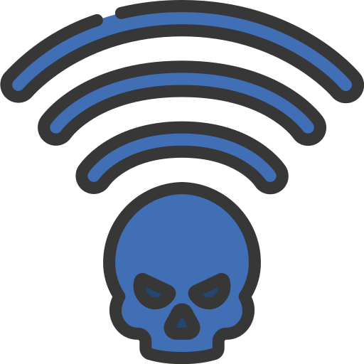
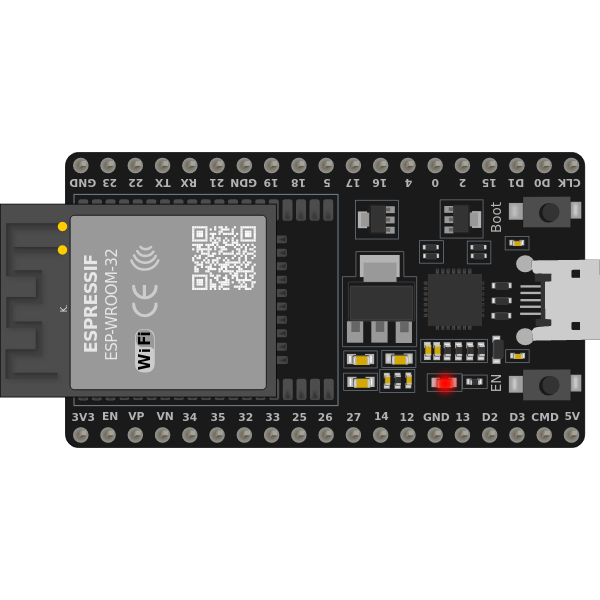

<h3 align="center">ESP32 WiFi Security Lab</h3>
<p align="center">Evil-twin captive-portal demo for teaching WiFi credential-harvesting risk</p>

<p align="center">
  
  
</p>

## Overview

This project runs a classic **evil-twin / captive-portal attack** on an ESP32:
it broadcasts an open WiFi network, forces every connected client's DNS
lookups back to itself, and serves a fake "sign in to use WiFi" page that
captures whatever email/password is typed in. It's the same technique used
in real-world public-WiFi credential theft, built as a self-contained lab so
the mechanics (rogue AP, DNS hijack, captive-portal redirect, plaintext
credential capture) can be inspected and demonstrated hands-on instead of
only read about.

**It is a teaching tool for a closed lab, not a plug-and-play attack kit.**
The portal uses a fictional brand ("SkyLink Free WiFi") rather than
impersonating any real network, and every page carries a visible
`LAB USE ONLY` banner so it's never mistaken for a genuine captive portal.
Don't rename the SSID/branding to impersonate a real business or network —
see [Legal & ethical use](#legal--ethical-use).

## How it works

1. **Rogue AP** — the ESP32 starts an open WiFi access point (no password),
   which is itself the first part of the attack: an open network with a
   plausible name is enough to get phones to auto-join or users to connect
   without thinking twice.
2. **DNS hijack** — a `DNSServer` instance resolves *every* hostname to the
   ESP32's own IP, so no matter what site a freshly connected device tries
   to reach, it lands on the portal.
3. **Captive-portal redirect** — any unmatched HTTP request (`onNotFound`)
   is 302'd to `/portal`, mimicking how real OS captive-portal detection
   triggers a "sign in to network" prompt.
4. **Credential capture** — `/login` stores submitted credentials in an
   in-memory ring buffer (`MAX_STORED_CREDENTIALS`, default 10) and logs them
   over Serial, deliberately in plaintext, to make the core lesson visible:
   **a captive portal can read everything you type into it.**
5. **Dashboard** — `/dashboard` lists captured submissions and the number
   of connected stations; `/download` exports them as a `.txt` file.

```
 client device                         ESP32
 ─────────────                         ─────
 joins "SkyLink Free WiFi (LAB)"  ──▶  softAP (open)
 any DNS query                    ──▶  DNSServer → always resolves to ESP32
 any HTTP request                 ──▶  WebServer → 302 → /portal
 submits sign-in form             ──▶  /login → stored in RAM, logged to Serial
 operator checks results          ──▶  /dashboard, /download
```

## Hardware & software requirements

- Any ESP32 dev board (tested shape: ESP32-WROOM-32).
- USB cable + Arduino IDE (or PlatformIO) with the **ESP32 board package**
  installed.
- Libraries used: `WiFi.h`, `WebServer.h`, `DNSServer.h`, `SPIFFS.h` — all
  ship with the ESP32 Arduino core, no extra installs needed.

## Project structure

```
src/
  esp32_wifi_lab.ino   main sketch: routing, AP/DNS setup, credential capture
  portal_page.h         sign-in page + dashboard HTML (PROGMEM, flash-resident)
  config.h               SSID, banner text, buffer size — change behavior here
data/
  logo.png                image served on the portal (flashed to SPIFFS)
docs/images/               README assets
```

## Setup

1. **Flash the data partition** (serves `logo.png` on the portal page):
   - In Arduino IDE, install the "ESP32 Sketch Data Upload" tool if you
     haven't already, then with `src/` open as the sketch folder and a
     `data/` folder next to it, run *Tools → ESP32 Sketch Data Upload*.
   - In PlatformIO: `pio run --target uploadfs`.
2. **Flash the sketch:** open `src/esp32_wifi_lab.ino` in Arduino IDE,
   select your board/port, and upload.
3. **Connect:** on a *second* device on your bench network, join
   `SkyLink Free WiFi (LAB)` and open a browser — you should land on the
   lab sign-in page automatically (or navigate to `http://192.168.4.1/`).
4. **Review captures:** browse to `http://192.168.4.1/dashboard` from the
   ESP32's AP, or watch the Serial monitor at 115200 baud.

## Legal & ethical use

This technique — standing up an open network and a fake sign-in page to
capture credentials — **is illegal to run against networks and people
without consent** in most jurisdictions (commonly covered by
unauthorized-access, wiretapping, and fraud statutes). Use this project
only:

- on hardware and a wireless range you own or control, with no
  unconsenting third parties in range, **or**
- inside a scoped, written-authorization penetration test / red-team
  engagement that explicitly covers wireless social engineering, **or**
- on an isolated CTF/training range built for this purpose.

Don't rebrand the portal to impersonate a real company, carrier, venue, or
airport, and don't deploy it anywhere members of the public could connect
to it by mistake. The author is not responsible for misuse.

## Defending against this (the other half of the lesson)

- Prefer networks you've connected to before and that require WPA2/WPA3 —
  be suspicious of open "Free WiFi" SSIDs, especially ones with generic
  airport/café-style names.
- A captive portal asking for an *email + password* (rather than just
  accepting terms, or using a carrier SSO) is a red flag — real venue WiFi
  rarely needs your email password to grant internet access.
- Use a VPN on untrusted networks so even a successful DNS hijack/MITM
  can't read your traffic.
- On mobile, disable auto-join for open networks and check the WiFi
  details screen for "weak security" / "no internet" warnings before
  entering anything.

## Known limitations

- `/dashboard` and `/download` are unauthenticated — fine on an isolated
  bench network, not something to expose beyond that without adding auth.
- Credentials are kept in a RAM ring buffer only and are lost on reboot by
  design; this isn't meant to be a persistent logger.
- Tested against the OS captive-portal detectors on current Android/iOS;
  behavior can vary by OS version.

## License

MIT — see [LICENSE](LICENSE).
